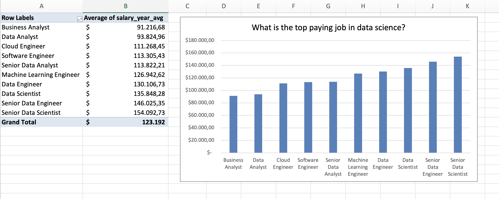
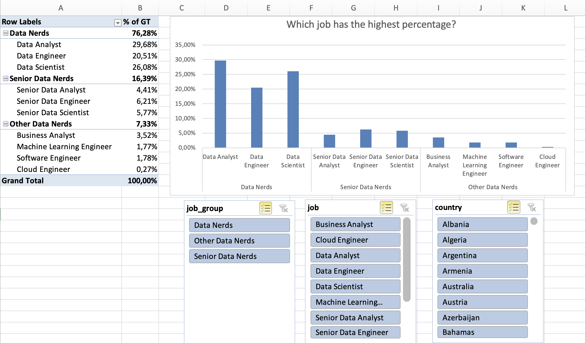
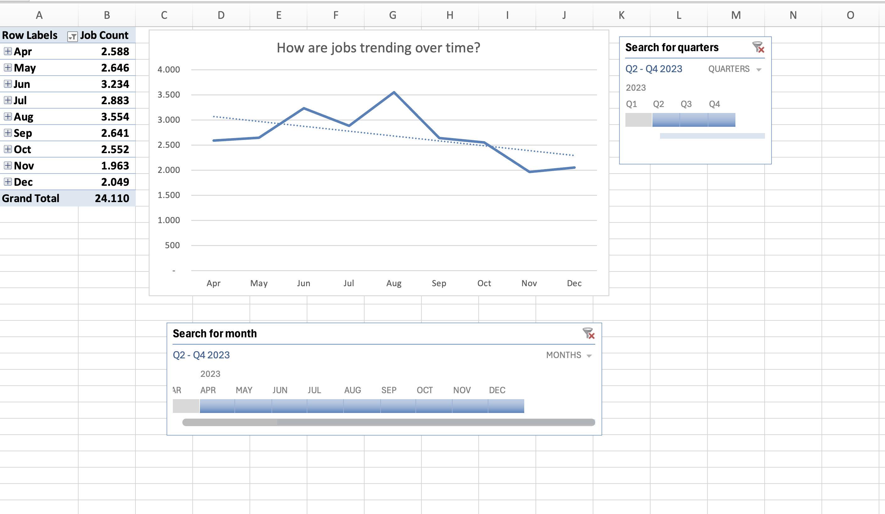

# 📈 Data Jobs Market, Salary & Trend Analysis (2023)

## 📌 Project Overview
This project analyzes **24,110 data-related job postings** across April–December 2023 using **Microsoft Excel PivotTables, Slicers, and Timelines**. Job roles are grouped into **Data Nerds**, **Senior Data Nerds**, and **Other Data Nerds** to evaluate compensation levels, demand distribution, and hiring seasonality.

## 📊 Dashboard & Visual Analysis

### Role Distribution & Slicers

### 2023 Hiring Trend

## 🎯 Business Questions Answered
1. **Top Paying Roles:** Which data and tech positions offer the highest average annual salary (`salary_year_avg`)?
2. **Role & Group Share:** How is hiring demand distributed across **Data Nerds**, **Senior Data Nerds**, and **Other Data Nerds** (% of Grand Total)?
3. **Time & Seasonality Trends:** How did job posting volume fluctuate across months and quarters (`Q2–Q4 2023`), and how can stakeholders filter by role group, job title, or country?

## 🛠️ Tools & Excel Techniques Used
- **PivotTables & Value Summarization:** Built PivotTables calculating **Average of `salary_year_avg`**, **% of Grand Total (`% of GT`)**, and **Job Count** (`24,110` total postings).
- **Role Grouping:** Structured roles into **Data Nerds** (Data Analyst, Data Engineer, Data Scientist), **Senior Data Nerds** (Senior Data Analyst, Senior Data Engineer, Senior Data Scientist), and **Other Data Nerds** (Business Analyst, ML Engineer, Software Engineer, Cloud Engineer).
- **Interactive Filtering:** Added **Slicers** (`job_group` / `Data Nerd Group`, `job`, `country`) and **Timeline** controls (`Search for quarters`, `Search for month`) for interactive exploration.
- **Data Visualization:** Created Column Charts comparing average salaries and role share, alongside a Line Chart with a trendline tracking monthly job volume.

## 🔍 Key Insights
- **Highest Paying Roles:** **Senior Data Scientist** ($154.1k average) and **Senior Data Engineer** ($146.0k average) lead compensation, followed by **Data Scientist** ($135.8k) and **Data Engineer** ($130.1k), while **Data Analyst** ($93.8k) and **Business Analyst** ($91.2k) sit near the entry/core analyst tier.
- **Demand Concentration:** **Data Nerds** account for **76.28%** of total listings—led by **Data Analyst (29.68%)**, **Data Scientist (26.08%)**, and **Data Engineer (20.51%)**—while **Senior Data Nerds** represent **16.39%** and **Other Data Nerds** make up **7.33%**.
- **2023 Hiring Trend:** Across `24,110` postings from April to December 2023, hiring peaked in **August (3,554)** and **June (3,234)** before tapering off toward **November (1,963)** and **December (2,049)**.

## 🚀 How to Use
1. Download the Excel workbook from this repository and open it in **Microsoft Excel**.
2. Navigate across the analysis sheets (`Salary_Final`, `%GT_Original`, `%GT_Final`, `Count_Final`).
3. Click the **Slicers** (`Data Nerd Group`, `job`, `country`) or **Timeline** (`Q2–Q4 2023`) to dynamically slice the tables and charts.
